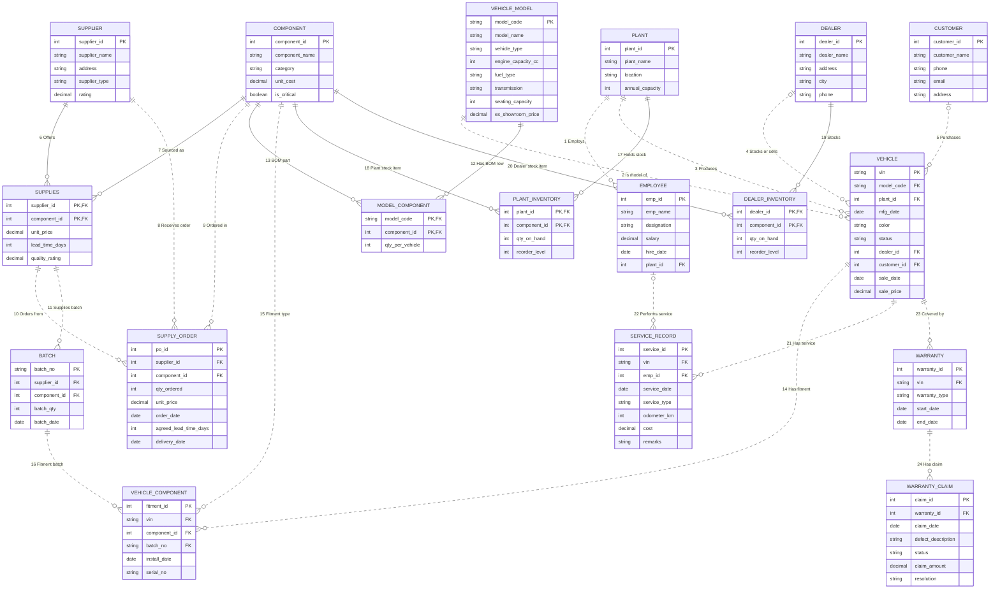

# Q1 — E-R Diagram: Integrated Two-Wheeler Manufacturing Database Management System

## 1. Requirements Recap (from Set-B Case Study)

A two-wheeler manufacturing company makes **Motorcycles, Scooters, Electric Scooters, Electric Motorcycles**.
It has multiple **manufacturing plants**, a network of **suppliers** and **authorized dealers**, and needs an
integrated system covering: vehicle models, components, suppliers, manufacturing, inventory, employees,
dealers, customers, sales, service and warranty — replacing today's separate, non-integrated systems.

Problems the design must solve:
- Track vehicles from manufacturing → dealer → customer delivery
- Reject duplicate vehicle keys and customer contact identifiers (UNIQUE constraints)
- Track which components (and from which supplier/batch) are fitted in each vehicle → defect recall support
- Supplier performance tracking (supply history, lead time)
- Correct inventory of components at plants and dealers
- Warranty claim tracking and service history
- Production cost calculation (component cost via Bill of Materials)

## 2. Entities and Attributes

There are **18 relations (tables)**: 13 core entities and five associative entities. A relation is a table; a relationship is a link between entities. These counts are different. The SQL defines **24 foreign-key relationships**, all listed in Section 3 and shown in the diagram.

| # | Entity / relation | Type | Primary key | Other attributes |
|---|---|---|---|---|
| 1 | **PLANT** | Strong | `plant_id` | `plant_name`, `location`, `annual_capacity` |
| 2 | **VEHICLE_MODEL** | Strong | `model_code` | `model_name`, `vehicle_type`, `engine_capacity_cc`, `fuel_type`, `transmission`, `seating_capacity`, `ex_showroom_price` |
| 3 | **COMPONENT** | Strong | `component_id` | `component_name`, `category`, `unit_cost`, `is_critical` |
| 4 | **SUPPLIER** | Strong | `supplier_id` | `supplier_name`, `address`, `supplier_type`, `rating` |
| 5 | **EMPLOYEE** | Strong | `emp_id` | `emp_name`, `designation`, `salary`, `hire_date`, `plant_id` |
| 6 | **DEALER** | Strong | `dealer_id` | `dealer_name`, `address`, `city`, `phone` |
| 7 | **CUSTOMER** | Strong | `customer_id` | `customer_name`, `phone`, `email`, `address` |
| 8 | **SUPPLIES** | Associative entity | `supplier_id`, `component_id` | `unit_price`, `lead_time_days`, `quality_rating` |
| 9 | **SUPPLY_ORDER** | Strong | `po_id` | `supplier_id`, `component_id`, `qty_ordered`, `unit_price`, `order_date`, `agreed_lead_time_days`, `delivery_date` |
| 10 | **BATCH** | Strong; existence-dependent | `batch_no` | `supplier_id`, `component_id`, `batch_qty`, `batch_date` |
| 11 | **MODEL_COMPONENT** | Associative entity | `model_code`, `component_id` | `qty_per_vehicle` |
| 12 | **VEHICLE** | Strong | `vin` | `model_code`, `plant_id`, `mfg_date`, `color`, `status`, `dealer_id`, `customer_id`, `sale_date`, `sale_price` |
| 13 | **VEHICLE_COMPONENT** | Associative entity | `fitment_id` | `vin`, `component_id`, `batch_no`, `install_date`, `serial_no` |
| 14 | **PLANT_INVENTORY** | Associative entity | `plant_id`, `component_id` | `qty_on_hand`, `reorder_level` |
| 15 | **DEALER_INVENTORY** | Associative entity | `dealer_id`, `component_id` | `qty_on_hand`, `reorder_level` |
| 16 | **SERVICE_RECORD** | Strong; existence-dependent | `service_id` | `vin`, `emp_id`, `service_date`, `service_type`, `odometer_km`, `cost`, `remarks` |
| 17 | **WARRANTY** | Strong | `warranty_id` | `vin`, `warranty_type`, `start_date`, `end_date` |
| 18 | **WARRANTY_CLAIM** | Strong | `claim_id` | `warranty_id`, `claim_date`, `defect_description`, `status`, `claim_amount`, `resolution` |

VEHICLE_COMPONENT has its own `fitment_id`: two tyres of the same component type and batch are two separate physical fitments. Q2 specifies domains, nullability, unique constraints and composite foreign keys.

## 3. All 24 implemented relationships

Each row below corresponds to one SQL FOREIGN KEY constraint. A composite foreign key counts as one relationship, not one per column. Every parent may have zero or many children, so its participation is `(0,N)`. The child participates in exactly one parent relationship `(1,1)` when mandatory, or zero or one `(0,1)` when nullable. All links below are 1:N from parent to child.

The earlier 16-item list grouped business concepts such as Supplies, Uses and Fitted-With. Expanding their associative entities and listing the direct supplier/component foreign keys on SUPPLY_ORDER gives these 24 implemented links. It does not add tables or change SQL behavior.

| # | Relationship | Parent → child | Child foreign key → parent key | Child participation |
|---|---|---|---|---|
| 1 | Employs | PLANT → EMPLOYEE | (plant_id) → (plant_id) | (1,1), total |
| 2 | Is model of | VEHICLE_MODEL → VEHICLE | (model_code) → (model_code) | (1,1), total |
| 3 | Produces | PLANT → VEHICLE | (plant_id) → (plant_id) | (1,1), total |
| 4 | Stocks or sells | DEALER → VEHICLE | (dealer_id) → (dealer_id) | (0,1), optional |
| 5 | Purchases | CUSTOMER → VEHICLE | (customer_id) → (customer_id) | (0,1), optional |
| 6 | Offers | SUPPLIER → SUPPLIES | (supplier_id) → (supplier_id) | (1,1), total |
| 7 | Sourced as | COMPONENT → SUPPLIES | (component_id) → (component_id) | (1,1), total |
| 8 | Receives order | SUPPLIER → SUPPLY_ORDER | (supplier_id) → (supplier_id) | (1,1), total |
| 9 | Ordered in | COMPONENT → SUPPLY_ORDER | (component_id) → (component_id) | (1,1), total |
| 10 | Orders from | SUPPLIES → SUPPLY_ORDER | (supplier_id, component_id) → (supplier_id, component_id) | (1,1), total |
| 11 | Supplies batch | SUPPLIES → BATCH | (supplier_id, component_id) → (supplier_id, component_id) | (1,1), total |
| 12 | Has BOM row | VEHICLE_MODEL → MODEL_COMPONENT | (model_code) → (model_code) | (1,1), total |
| 13 | BOM part | COMPONENT → MODEL_COMPONENT | (component_id) → (component_id) | (1,1), total |
| 14 | Has fitment | VEHICLE → VEHICLE_COMPONENT | (vin) → (vin) | (1,1), total |
| 15 | Fitment type | COMPONENT → VEHICLE_COMPONENT | (component_id) → (component_id) | (1,1), total |
| 16 | Fitment batch | BATCH → VEHICLE_COMPONENT | (batch_no, component_id) → (batch_no, component_id) | (1,1), total |
| 17 | Holds stock | PLANT → PLANT_INVENTORY | (plant_id) → (plant_id) | (1,1), total |
| 18 | Plant stock item | COMPONENT → PLANT_INVENTORY | (component_id) → (component_id) | (1,1), total |
| 19 | Stocks | DEALER → DEALER_INVENTORY | (dealer_id) → (dealer_id) | (1,1), total |
| 20 | Dealer stock item | COMPONENT → DEALER_INVENTORY | (component_id) → (component_id) | (1,1), total |
| 21 | Has service | VEHICLE → SERVICE_RECORD | (vin) → (vin) | (1,1), total |
| 22 | Performs service | EMPLOYEE → SERVICE_RECORD | (emp_id) → (emp_id) | (0,1), optional |
| 23 | Covered by | VEHICLE → WARRANTY | (vin) → (vin) | (1,1), total |
| 24 | Has claim | WARRANTY → WARRANTY_CLAIM | (warranty_id) → (warranty_id) | (1,1), total |

The direct SUPPLIER → SUPPLY_ORDER and COMPONENT → SUPPLY_ORDER constraints coexist with the composite SUPPLIES → SUPPLY_ORDER constraint. The latter additionally verifies that the supplier/component pair is approved. BATCH → VEHICLE_COMPONENT uses `(batch_no, component_id)` so a fitted part cannot refer to a batch of a different component.

## 4. E-R Diagram (Chen notation)

The diagram shows all **18 distinct entities and 24 numbered relationships** in four connected domain views. Repeated entity names across views refer to the same table, not extra entities. Relationship numbers correspond exactly to Section 3.

Rectangles denote entities, ovals denote primary-key attributes, diamonds denote relationships and underlined attributes denote keys. Double lines show mandatory child participation. Labels `(0,N)`, `(1,1)` and `(0,1)` describe the participation of the adjacent entity. Only keys are drawn as ovals to keep the diagram readable; Section 2 lists every attribute.


[Open the full-resolution ER diagram](chen_er_diagram.png)

All five associative entities are explicit rectangles, including VEHICLE_COMPONENT and its physical-part key `fitment_id`. Every foreign-key constraint in Q3 has a corresponding diamond.

### Equivalent crow's-foot source

> Paste the block below into any Mermaid renderer (mermaid.live, VS Code Markdown preview) to see the diagram.



## 5. Notation and hand-drawn submission

The Mermaid diagram uses crow's-foot notation. `||` means exactly one, `o{` means zero or many, and `|o` at the left endpoint means zero or one. Solid lines identify child rows through a parent key; dotted lines are non-identifying relationships. A foreign key alone does not make a relationship identifying.

For a Chen drawing, use rectangles for entities, diamonds for relationships, underline keys, and use double participation lines only for the total sides listed in Section 3. Useful relationship paths are:

```text
PLANT          -- Produces       -- VEHICLE          (1:N)
VEHICLE_MODEL  -- Is-Model-Of    -- VEHICLE          (1:N)
SUPPLIER       -- Supplies       -- COMPONENT        (M:N; price, lead time, rating)
VEHICLE_MODEL  -- Uses-BOM       -- COMPONENT        (M:N; quantity per vehicle)
PLANT          -- Holds-Stock    -- COMPONENT        (M:N; quantity, reorder level)
DEALER         -- Stocks         -- COMPONENT        (M:N; quantity, reorder level)
PLANT          -- Employs        -- EMPLOYEE         (1:N)
VEHICLE        -- Has-Service    -- SERVICE_RECORD   (1:N)
EMPLOYEE       -- Performs       -- SERVICE_RECORD   (1:N; optional employee)
VEHICLE        -- Covered-By     -- WARRANTY         (1:N)
WARRANTY       -- Has-Claim      -- WARRANTY_CLAIM   (1:N)
DEALER         -- Stocks-or-Sells -- VEHICLE         (1:N; optional dealer)
CUSTOMER       -- Purchases      -- VEHICLE          (1:N; optional customer)
```

Represent each physical fitment as a VEHICLE_COMPONENT entity with its own `fitment_id`, connected to one VEHICLE, one COMPONENT and one BATCH. Reify the Supplies relationship as the SUPPLIES associative entity when connecting it to BATCH and SUPPLY_ORDER. Those children reference the complete supplier/component pair. BATCH and SERVICE_RECORD have their own identifiers and therefore use ordinary entity rectangles, not weak-entity double rectangles.

The diagram abbreviates composite constraints: BATCH and SUPPLY_ORDER each reference SUPPLIES(supplier_id, component_id); VEHICLE_COMPONENT references BATCH(batch_no, component_id). The fitment serial uniqueness rule is UNIQUE(component_id, serial_no). Q2 lists these constraints explicitly.

## 6. Design decisions and scope

1. **Batch identity:** `batch_no` is an internal globally unique lot code. It does not assume different suppliers coordinate their own batch numbering. BATCH is existence-dependent through SUPPLIES but has its own complete primary key.
2. **BOM versus original build:** MODEL_COMPONENT records required quantities; VEHICLE_COMPONENT records individual physical parts, with separate fitment IDs for two tyres or other repeated components. Serials, when present, are assumed unique within a component type. The sample records demonstrate traceability rather than a complete build manifest for every vehicle. Subsequent replacements are described in service/claim records; this is not a full part-transfer history.
3. **Contact uniqueness:** phone/email constraints reject repeated contact identifiers. They assume distinct customer/dealer contacts; records with different contacts may still describe the same person and require reconciliation.
4. **Inventory:** plant/dealer quantities and reorder levels support stock reporting. Receipts, consumption and adjustments must update stock transactionally; the sample does not implement a stock-movement ledger.
5. **Supplier performance:** each SUPPLY_ORDER stores its agreed lead time and actual delivery date. Later changes to the current SUPPLIES lead time do not alter historical on-time counts. Quality rating is a current value on SUPPLIES, not per-order quality history. An undelivered order is not counted as on-time; that alone does not classify it as overdue.
6. **Warranty and service:** a vehicle can have several policies and service records; claims belong to a policy. An employee is optional on a service record because it can be unknown or removed.
7. **Sales:** the model records one original sale per vehicle. Status and sale fields track the current manufacturing/dealer/customer stage. Sold requires dealer, customer, sale date and positive price; At-Dealer requires a dealer and no customer; plant stages have neither. A detailed shipping or resale history is outside this schema.
8. **Cost estimate:** the BOM query calculates material cost using current component costs. It excludes labour, overhead and historical purchase-cost variation, so it is not a complete accounting production cost.
