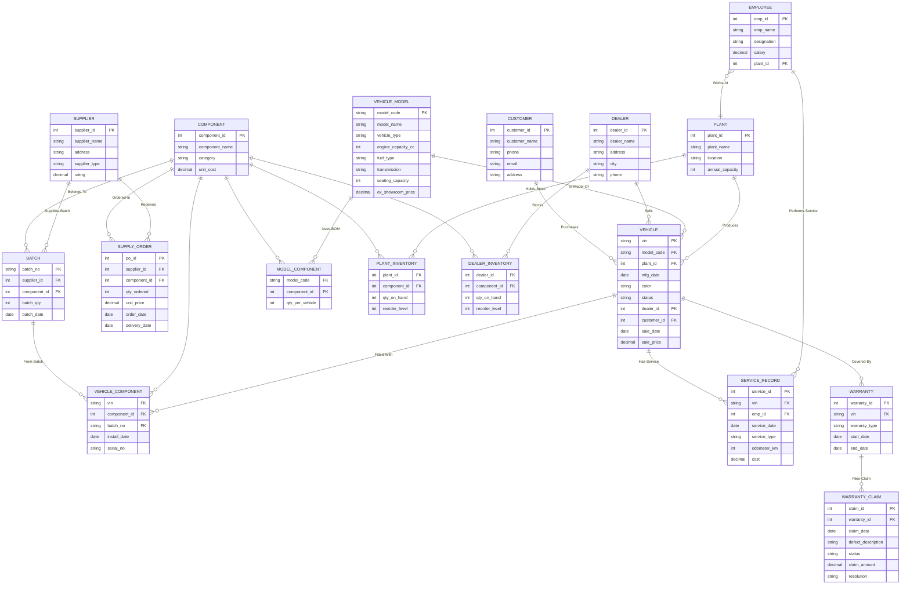

# Q1 — E-R Diagram: Integrated Two-Wheeler Manufacturing Database Management System

## 1. Requirements Recap (from Set-B Case Study)

A two-wheeler manufacturing company makes **Motorcycles, Scooters, Electric Scooters, Electric Motorcycles**.
It has multiple **manufacturing plants**, a network of **suppliers** and **authorized dealers**, and needs an
integrated system covering: vehicle models, components, suppliers, manufacturing, inventory, employees,
dealers, customers, sales, service and warranty — replacing today's separate, non-integrated systems.

Problems the design must solve:
- Track vehicles from manufacturing → dealer → customer delivery
- Eliminate duplicate customer / vehicle records (use keys + UNIQUE constraints)
- Track which components (and from which supplier/batch) are fitted in each vehicle → defect recall support
- Supplier performance tracking (supply history, lead time)
- Correct inventory of components at plants and dealers
- Warranty claim tracking and service history
- Production cost calculation (component cost via Bill of Materials)

## 2. Entities and Attributes

| # | Entity | Type | Key Attributes | Other Attributes |
|---|--------|------|----------------|------------------|
| 1 | **VEHICLE_MODEL** | Strong | `model_code` (PK) — e.g. `XSP1660` | model_name (e.g. X-Sport 160), vehicle_type (Motorcycle/Scooter/E-Scooter/E-Motorcycle), engine_capacity_cc (NULL for electric), fuel_type (Petrol/Electric), transmission, seating_capacity, ex_showroom_price |
| 2 | **COMPONENT** | Strong | `component_id` (PK) | component_name (Engine, Battery, Brake assembly, Tyre, Wheel, Headlamp, ECU, Clutch Assembly, Suspension...), category, unit_cost, is_critical |
| 3 | **SUPPLIER** | Strong | `supplier_id` (PK) | supplier_name, address, supplier_type (OEM/Aftermarket), rating |
| 4 | **PLANT** | Strong | `plant_id` (PK) | plant_name, location, annual_capacity |
| 5 | **EMPLOYEE** | Strong | `emp_id` (PK) | emp_name, designation, salary, hire_date |
| 6 | **DEALER** | Strong | `dealer_id` (PK) | dealer_name, address, city, phone (phone UNIQUE — avoids duplicates) |
| 7 | **CUSTOMER** | Strong | `customer_id` (PK) | customer_name, phone (UNIQUE), email (UNIQUE), address — UNIQUE constraints prevent duplicate records |
| 8 | **VEHICLE** | Strong | `vin` (chassis no, PK) | model_code (FK), plant_id (FK), mfg_date, color, status (In-Production/At-Plant/At-Dealer/Sold) |
| 9 | **BATCH** (of a component) | Weak (depends on SUPPLIER, COMPONENT) | `batch_no` (partial), supplier_id + component_id (discriminators) | mfg_date_of_batch, qty_in_batch |
| 10 | **SERVICE_RECORD** | Weak (identified by vehicle + date, or given its own ID) | `service_id` (PK) | vin (FK), service_date, service_type, odometer_km, cost, remarks |
| 11 | **WARRANTY** | Strong | `warranty_id` (PK) | vin (FK), warranty_type (Standard/Extended), start_date, end_date, duration_months |
| 12 | **WARRANTY_CLAIM** | Strong | `claim_id` (PK) | warranty_id (FK), claim_date, defect_description, status (Open/Approved/Rejected/Resolved), claim_amount, resolution |
| 13 | **SUPPLY_ORDER** (optional, for supplier performance) | Strong | `po_id` (PK) | supplier_id, component_id, order_date, qty_ordered, unit_price, delivery_date |

## 3. Relationships (with cardinality and participation)

| # | Relationship | Entities | Cardinality | Participation | Descriptive Attributes |
|---|--------------|----------|-------------|---------------|------------------------|
| 1 | **Produces** | PLANT — VEHICLE | 1 : N | PLANT partial, VEHICLE total | mfg_date, shift |
| 2 | **Is-Model-Of** | VEHICLE_MODEL — VEHICLE | 1 : N | both partial (model may exist before any vehicle) | — |
| 3 | **Supplies** | SUPPLIER — COMPONENT | **M : N** | total on COMPONENT side | avg unit_price, lead_time_days, quality_rating (kept as history in SUPPLY_ORDER) |
| 4 | **Supplies-Batch** | SUPPLIER — BATCH, COMPONENT — BATCH | identifying, N:1 each | total | batch_no, batch_qty, batch_date |
| 5 | **Uses** (Bill of Materials / design) | VEHICLE_MODEL — COMPONENT | **M : N** | partial | qty_per_vehicle |
| 6 | **Fitted-With** (as-built) | VEHICLE — COMPONENT (via BATCH) | **M : N** | total on VEHICLE side | install_date, serial_no — *this is what makes defect recalls possible: given a defective batch, find all VINs* |
| 7 | **Holds-Stock** (inventory at plants) | PLANT — COMPONENT | **M : N** | partial | quantity_on_hand, reorder_level |
| 8 | **Stocks** (inventory at dealers) | DEALER — COMPONENT | **M : N** | partial | quantity_on_hand, reorder_level |
| 9 | **Works-At** | EMPLOYEE — PLANT | N : 1 | total on EMPLOYEE | — |
| 10 | **Performs-Service** | EMPLOYEE — SERVICE_RECORD | 1 : N | partial on EMPLOYEE | labour_hours |
| 11 | **Has-Service** | VEHICLE — SERVICE_RECORD | 1 : N | total on SERVICE_RECORD | — |
| 12 | **Covered-By** | VEHICLE — WARRANTY | 1 : N (a vehicle can have Standard + Extended) | total on WARRANTY | — |
| 13 | **Files-Claim** | WARRANTY — WARRANTY_CLAIM | 1 : N | total on CLAIM | — |
| 14 | **Places-Order** | SUPPLIER — SUPPLY_ORDER — COMPONENT (ternary-ish chain) | M:1 / 1:N | partial | qty_ordered, unit_price, order_date, delivery_date |
| 15 | **Sells** | DEALER — VEHICLE | 1 : N | partial | — |
| 16 | **Purchases** (Sale) | CUSTOMER — VEHICLE | 1 : N | partial on both | sale_date, sale_price, payment_mode — modelled as SALE relationship; recorded only when status = Sold |


## 4. E-R Diagram (rendered as Mermaid)

> Paste the block below into any Mermaid renderer (mermaid.live, VS Code Markdown preview) to see the diagram.



## 5. Chen Notation Summary (for hand-drawn submission)

```
 [VEHICLE_MODEL] ──1──< Is-Model-Of >──N── [VEHICLE]
                                          /  |  \
                       1 <Produces>──── N    |   N ──< Purchases >──1── [CUSTOMER]
                      /                      |                      (sale_date, price)
                 [PLANT]                     N
                   │  \                 < Sells >──1── [DEALER]
                   │   N──< Works-At >──[EMPLOYEE]
                   │                        │
      <Holds-Stock>│                        │1──< Performs-Service >──N── [SERVICE_RECORD]
                   │                        │                                │ N
      [PLANT_INVENTORY]                     │                            < Has-Service >
                   \ M                      │ N                                │ N
              [COMPONENT]═══════════════════╪══════════════════════════════════┘
               /  |  \                      | M
              /   |   \──< Uses-BOM >──[VEHICLE_MODEL]                [VEHICLE]──1──< Covered-By >──N── [WARRANTY]
             M    M                                                              │1
   <Stocks>│    │< Supplies >                                                    │N
            │    │ (price, lead_time)                                    < Files-Claim >
   [DEALER_INVENTORY]  │                                                  │
                  [SUPPLIER]══════< Supplies-Batch >═══ [BATCH] ──< From-Batch >──(VEHICLE_COMPONENT)
                                        (M:N SUPPLIER—COMPONENT via batch, with
                                         price, lead_time, batch_qty)
```

**Notation:** `[ ]` = entity, `< >` = relationship diamond, `═` = M:N relationship, `──` = 1:N.
`VEHICLE_COMPONENT` (Fitted-With) is the associative diamond between VEHICLE, COMPONENT and BATCH
carrying `install_date` and `serial_no` — the heart of defect-tracing.

## 6. Design Decisions (justify in viva)

1. **BATCH as a weak entity** of (SUPPLIER, COMPONENT) — this directly answers *"identifying vehicles affected by defective components"*: recall = all VINs in `VEHICLE_COMPONENT` with a given defective `batch_no`.
2. **Separate BOM (`MODEL_COMPONENT`) vs as-built (`VEHICLE_COMPONENT`)** — design vs actual manufacture; serial numbers of critical parts (ECU, engine, battery) are tracked per vehicle.
3. **Customer/Dealer uniqueness** — phone/email UNIQUE constraints eliminate duplicate records flagged in the case study.
4. **Inventory as two M:N relationships** (PLANT–COMPONENT, DEALER–COMPONENT) with qty + reorder level → correct stock information.
5. **SUPPLY_ORDER** keeps the full supply history so **supplier performance** (on-time %, quality rating) is computable.
6. **WARRANTY separated from WARRANTY_CLAIM** — one vehicle may have multiple warranty policies and multiple claims over time.
7. **Sale modelled as attributes/relationship on VEHICLE–CUSTOMER** (a vehicle is sold once — 1:N from customer); status field on VEHICLE tracks *manufacturing → dealer → customer* delivery.

