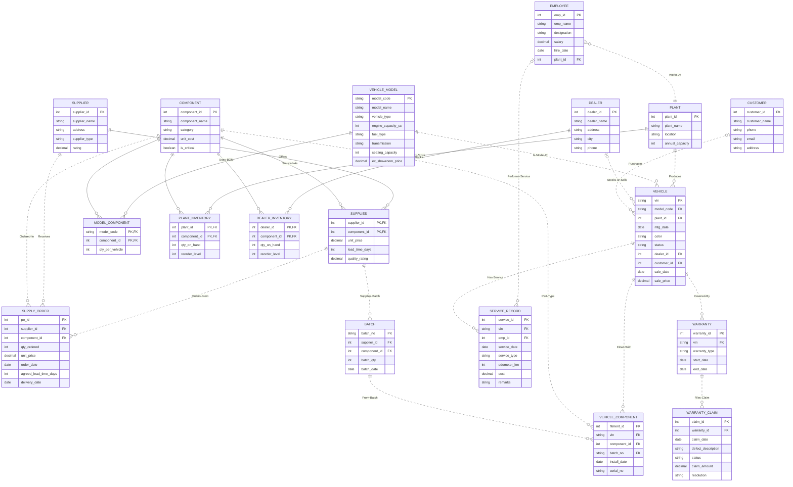

# Q1 — E-R Diagram: Integrated Two-Wheeler Manufacturing Database Management System

## 1. Requirements Recap (from Set-B Case Study)

A two-wheeler manufacturing company makes **Motorcycles, Scooters, Electric Scooters, Electric Motorcycles**.
It has multiple **manufacturing plants**, a network of **suppliers** and **authorized dealers**, and needs an
integrated system covering: vehicle models, components, suppliers, manufacturing, inventory, employees,
dealers, customers, sales, service and warranty — replacing today's separate, non-integrated systems.

Problems the design must solve:
- Track vehicles from manufacturing → dealer → customer delivery
- Reject duplicate vehicle keys and customer contact identifiers (UNIQUE constraints)
- Track which components (and from which supplier/batch) are fitted in each vehicle → defect recall support
- Supplier performance tracking (supply history, lead time)
- Correct inventory of components at plants and dealers
- Warranty claim tracking and service history
- Production cost calculation (component cost via Bill of Materials)

## 2. Entities and Attributes

| # | Entity | Type | Key Attributes | Other Attributes |
|---|--------|------|----------------|------------------|
| 1 | **VEHICLE_MODEL** | Strong | `model_code` (PK) — e.g. `XSP160` | model_name (e.g. X-Sport 160), vehicle_type (Motorcycle/Scooter/E-Scooter/E-Motorcycle), engine_capacity_cc (NULL for electric), fuel_type (Petrol/Electric), transmission, seating_capacity, ex_showroom_price |
| 2 | **COMPONENT** | Strong | `component_id` (PK) | component_name (Engine, Battery, Brake assembly, Tyre, Wheel, Headlamp, ECU, Clutch Assembly, Suspension...), category, unit_cost, is_critical |
| 3 | **SUPPLIER** | Strong | `supplier_id` (PK) | supplier_name, address, supplier_type (OEM/Aftermarket), rating |
| 4 | **PLANT** | Strong | `plant_id` (PK) | plant_name, location, annual_capacity |
| 5 | **EMPLOYEE** | Strong | `emp_id` (PK) | emp_name, designation, salary, hire_date |
| 6 | **DEALER** | Strong | `dealer_id` (PK) | dealer_name, address, city, phone (phone UNIQUE — rejects repeated phone values) |
| 7 | **CUSTOMER** | Strong | `customer_id` (PK) | customer_name, phone (UNIQUE), email (UNIQUE), address — UNIQUE constraints reject repeated contact values |
| 8 | **VEHICLE** | Strong | `vin` (chassis no, PK) | model_code (FK), plant_id (FK), mfg_date, color, status (In-Production/At-Plant/At-Dealer/Sold), dealer_id (nullable FK), customer_id (nullable FK), sale_date, sale_price |
| 9 | **BATCH** (of a component) | Strong; existence-dependent | `batch_no` (PK; globally unique internal lot code) | supplier_id + component_id (composite FK to SUPPLIES), batch_qty, batch_date |
| 10 | **SERVICE_RECORD** | Strong; existence-dependent | `service_id` (PK) | vin (FK), emp_id (nullable FK), service_date, service_type, odometer_km, cost, remarks |
| 11 | **WARRANTY** | Strong | `warranty_id` (PK) | vin (FK), warranty_type (Standard/Extended), start_date, end_date |
| 12 | **WARRANTY_CLAIM** | Strong | `claim_id` (PK) | warranty_id (FK), claim_date, defect_description, status (Open/Approved/Rejected/Resolved), claim_amount, resolution |
| 13 | **SUPPLY_ORDER** | Strong | `po_id` (PK) | supplier_id, component_id, order_date, qty_ordered, unit_price, agreed_lead_time_days, delivery_date |

Associative entities are **SUPPLIES**, **MODEL_COMPONENT**, **VEHICLE_COMPONENT**, **PLANT_INVENTORY**, and **DEALER_INVENTORY**. Their full attributes appear in the diagram. VEHICLE_COMPONENT has its own `fitment_id`; each row represents one physical part in the original build, so a vehicle can contain two tyres of the same component type.

## 3. Relationships (with cardinality and participation)

| # | Relationship | Entities | Cardinality | Participation | Descriptive Attributes |
|---|--------------|----------|-------------|---------------|------------------------|
| 1 | **Produces** | PLANT — VEHICLE | 1 : N | PLANT partial, VEHICLE total | mfg_date on VEHICLE |
| 2 | **Is-Model-Of** | VEHICLE_MODEL — VEHICLE | 1 : N | MODEL partial, VEHICLE total | — |
| 3 | **Supplies** | SUPPLIER — COMPONENT | **M : N** | both partial (catalogue entries may precede sourcing) | current unit_price, lead_time_days, quality_rating |
| 4 | **Supplies-Batch** | SUPPLIES — BATCH | 1 : N, non-identifying | total on BATCH | batch_no, batch_qty, batch_date |
| 5 | **Uses** (Bill of Materials / design) | VEHICLE_MODEL — COMPONENT | **M : N** | partial | qty_per_vehicle |
| 6 | **Fitted-With** (as-built) | VEHICLE — COMPONENT (via BATCH) | **M : N**, repeated physical parts allowed | partial | fitment_id, install_date, serial_no; every fitment has one vehicle, component and matching batch |
| 7 | **Holds-Stock** (inventory at plants) | PLANT — COMPONENT | **M : N** | partial | quantity_on_hand, reorder_level |
| 8 | **Stocks** (inventory at dealers) | DEALER — COMPONENT | **M : N** | partial | quantity_on_hand, reorder_level |
| 9 | **Works-At** | EMPLOYEE — PLANT | N : 1 | total on EMPLOYEE | — |
| 10 | **Performs-Service** | EMPLOYEE — SERVICE_RECORD | 1 : N | partial on both; employee may be unknown or deleted | — |
| 11 | **Has-Service** | VEHICLE — SERVICE_RECORD | 1 : N | total on SERVICE_RECORD | — |
| 12 | **Covered-By** | VEHICLE — WARRANTY | 1 : N (a vehicle can have Standard + Extended) | total on WARRANTY | — |
| 13 | **Files-Claim** | WARRANTY — WARRANTY_CLAIM | 1 : N | total on CLAIM | — |
| 14 | **Orders-From** | SUPPLIES — SUPPLY_ORDER | 1 : N | total on SUPPLY_ORDER | qty_ordered, unit_price, order_date, agreed_lead_time_days, delivery_date |
| 15 | **Sells** | DEALER — VEHICLE | 1 : N | partial | — |
| 16 | **Purchases** (Sale) | CUSTOMER — VEHICLE | 1 : N | partial on both | sale_date, sale_price; recorded only when status = Sold |


## 4. E-R Diagram (Chen notation)

The drawing uses rectangles for entities, ovals for attributes, diamonds for relationships, underlined keys and double lines for total participation. Cardinality labels use 1, M and N for one-to-many and many-to-many relationships. The relationship table above specifies optional participation.


[Download the high-resolution ER diagram](chen_er_diagram.png)

The image is a conceptual overview. In the relational implementation, Fitted-With becomes VEHICLE_COMPONENT with a separate `fitment_id` for every physical part, including repeated parts from the same batch. The schema in Q2 and the equivalent source below specify its individual vehicle, component and batch relationships.

### Equivalent crow's-foot source

> Paste the block below into any Mermaid renderer (mermaid.live, VS Code Markdown preview) to see the diagram.



## 5. Notation and hand-drawn submission

The Mermaid diagram uses crow's-foot notation. `||` means exactly one, `o{` means zero or many, and `|o` at the left endpoint means zero or one. Solid lines identify child rows through a parent key; dotted lines are non-identifying relationships. A foreign key alone does not make a relationship identifying.

For a Chen drawing, use rectangles for entities, diamonds for relationships, underline keys, and use double participation lines only for the total sides listed in Section 3. Useful relationship paths are:

```text
PLANT          -- Produces       -- VEHICLE          (1:N)
VEHICLE_MODEL  -- Is-Model-Of    -- VEHICLE          (1:N)
SUPPLIER       -- Supplies       -- COMPONENT        (M:N; price, lead time, rating)
VEHICLE_MODEL  -- Uses-BOM       -- COMPONENT        (M:N; quantity per vehicle)
PLANT          -- Holds-Stock    -- COMPONENT        (M:N; quantity, reorder level)
DEALER         -- Stocks         -- COMPONENT        (M:N; quantity, reorder level)
PLANT          -- Employs        -- EMPLOYEE         (1:N)
VEHICLE        -- Has-Service    -- SERVICE_RECORD   (1:N)
EMPLOYEE       -- Performs       -- SERVICE_RECORD   (1:N; optional employee)
VEHICLE        -- Covered-By     -- WARRANTY         (1:N)
WARRANTY       -- Has-Claim      -- WARRANTY_CLAIM   (1:N)
DEALER         -- Stocks-or-Sells -- VEHICLE         (1:N; optional dealer)
CUSTOMER       -- Purchases      -- VEHICLE          (1:N; optional customer)
```

Represent each physical fitment as a VEHICLE_COMPONENT entity with its own `fitment_id`, connected to one VEHICLE, one COMPONENT and one BATCH. Reify the Supplies relationship as the SUPPLIES associative entity when connecting it to BATCH and SUPPLY_ORDER. Those children reference the complete supplier/component pair. BATCH and SERVICE_RECORD have their own identifiers and therefore use ordinary entity rectangles, not weak-entity double rectangles.

The diagram abbreviates composite constraints: BATCH and SUPPLY_ORDER each reference SUPPLIES(supplier_id, component_id); VEHICLE_COMPONENT references BATCH(batch_no, component_id). The fitment serial uniqueness rule is UNIQUE(component_id, serial_no). Q2 lists these constraints explicitly.

## 6. Design decisions and scope

1. **Batch identity:** `batch_no` is an internal globally unique lot code. It does not assume different suppliers coordinate their own batch numbering. BATCH is existence-dependent through SUPPLIES but has its own complete primary key.
2. **BOM versus original build:** MODEL_COMPONENT records required quantities; VEHICLE_COMPONENT records individual physical parts, with separate fitment IDs for two tyres or other repeated components. Serials, when present, are assumed unique within a component type. The sample records demonstrate traceability rather than a complete build manifest for every vehicle. Subsequent replacements are described in service/claim records; this is not a full part-transfer history.
3. **Contact uniqueness:** phone/email constraints reject repeated contact identifiers. They assume distinct customer/dealer contacts; records with different contacts may still describe the same person and require reconciliation.
4. **Inventory:** plant/dealer quantities and reorder levels support stock reporting. Receipts, consumption and adjustments must update stock transactionally; the sample does not implement a stock-movement ledger.
5. **Supplier performance:** each SUPPLY_ORDER stores its agreed lead time and actual delivery date. Later changes to the current SUPPLIES lead time do not alter historical on-time counts. Quality rating is a current value on SUPPLIES, not per-order quality history. An undelivered order is not counted as on-time; that alone does not classify it as overdue.
6. **Warranty and service:** a vehicle can have several policies and service records; claims belong to a policy. An employee is optional on a service record because it can be unknown or removed.
7. **Sales:** the model records one original sale per vehicle. Status and sale fields track the current manufacturing/dealer/customer stage. Sold requires dealer, customer, sale date and positive price; At-Dealer requires a dealer and no customer; plant stages have neither. A detailed shipping or resale history is outside this schema.
8. **Cost estimate:** the BOM query calculates material cost using current component costs. It excludes labour, overhead and historical purchase-cost variation, so it is not a complete accounting production cost.
